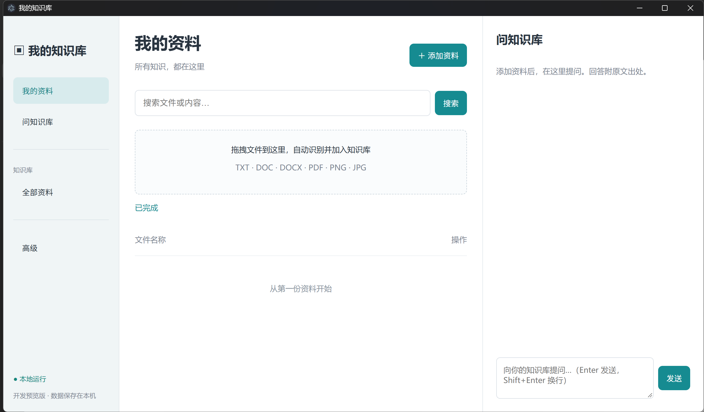
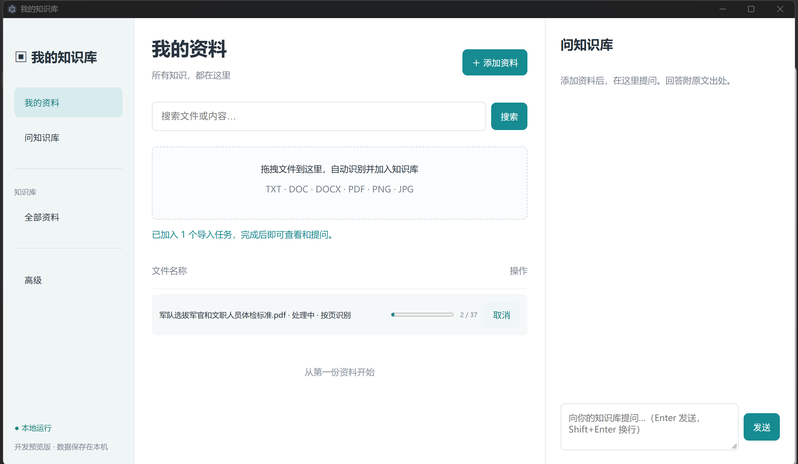
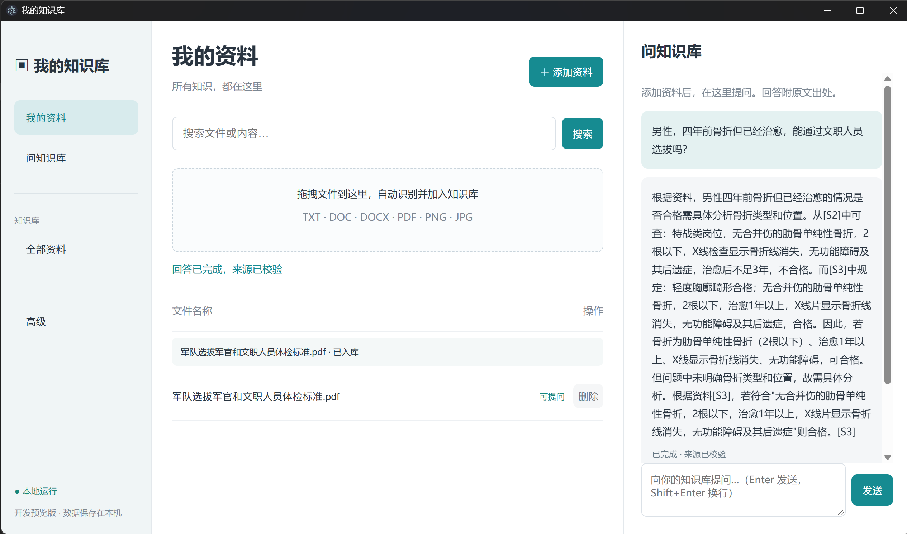
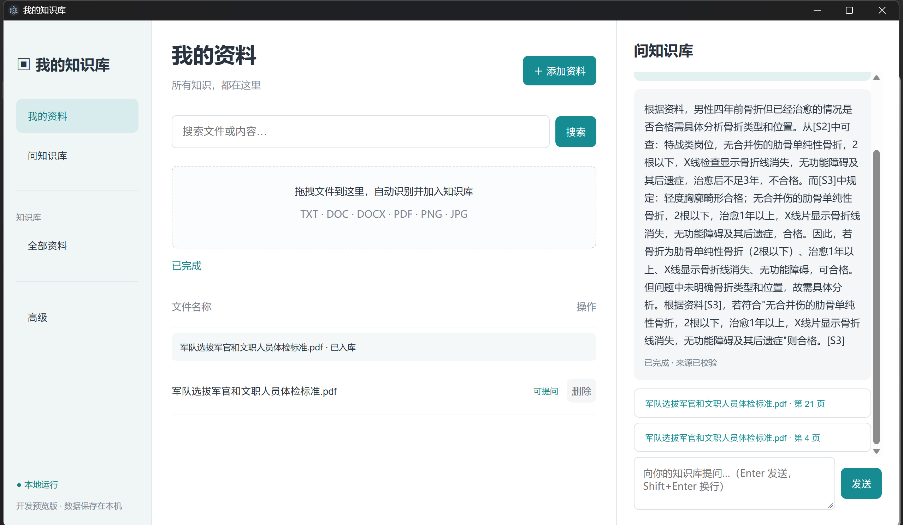
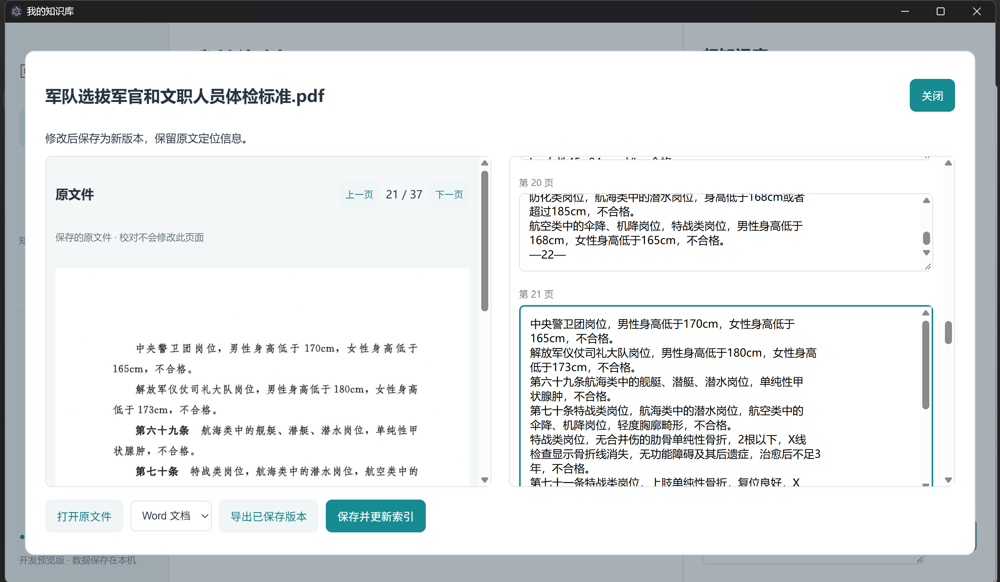
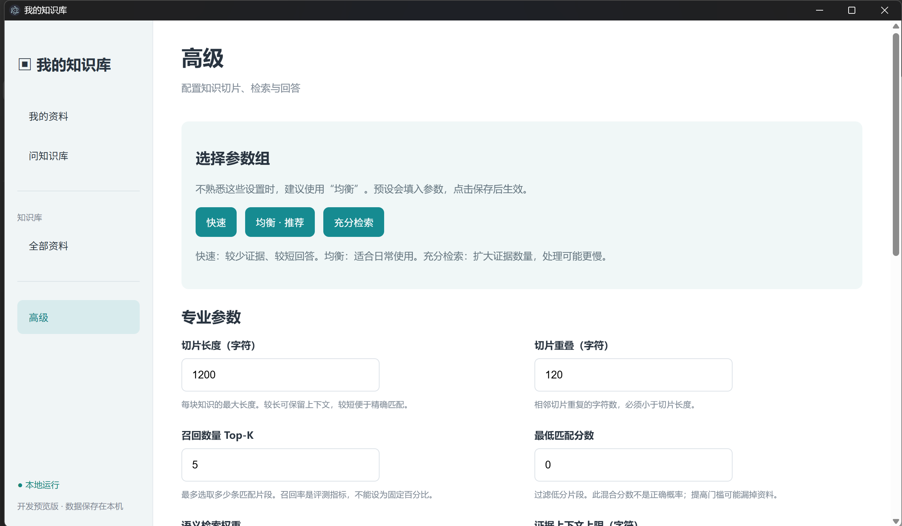
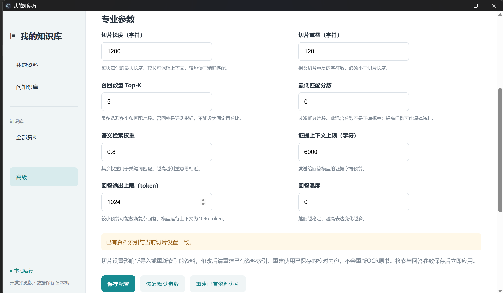
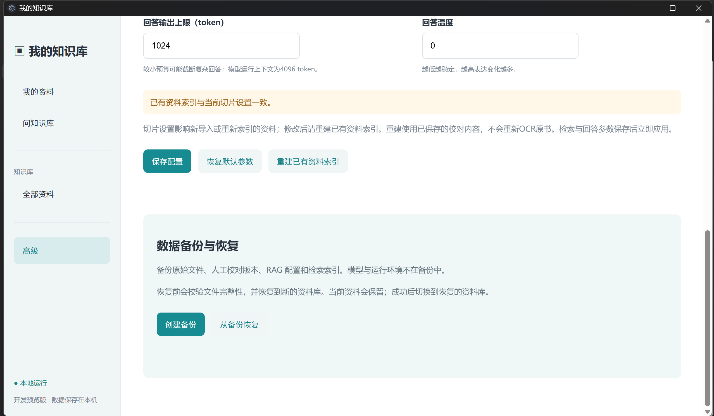

## 版权与源码说明

Copyright © 2026 paopaopaoper。本软件原创应用代码、原创界面及原创文档由项目作者保留著作权；当前采用闭源免费个人使用许可，详见 [COPYRIGHT.md](COPYRIGHT.md)。第三方模型、运行库和组件归各自权利人，依各自许可证授权。尚未宣称取得软件著作权登记证书。

本下载仓库不含私有项目源码。Release 底部 GitHub 自动生成的 Source code (zip/tar.gz) 对应下载仓库发布标签；v0.3.2 标签仅含 README.md，不能作为项目源码下载。这些自动生成入口不属于可删除的上传附件。SOURCES.md 是第三方来源与源码获取说明，须依法保留。

现有 Electron 安装包包含运行所需代码；ASAR 为封装而非加密，闭源许可不等于代码无法提取。

# RAG知识库下载资源

## 安装文件将以 Release 附件提供

文件包含两个：
KnowledgeBase-0.3.2-Setup.exe和KnowledgeBase-Resources.zip，其中setup.exe是安装引导程序，zip是模型文件
zip有点大哈，但这是免费本地自用的大前提，所以下载需等待

由于zip包大约4GB内容，GitHub Release 每个附件必须小于 2GiB，需要先拆分资源包，请下载之后使用整合工具合并文件

## Windows 安装说明

1. 下载或复制两个文件：`KnowledgeBase-0.3.2-Setup.exe` 与 `KnowledgeBase-Resources.zip`
2. 双击安装程序，按提示安装到当前用户环境。安装包未签名，Windows 可能显示信誉提示
3. 打开“KnowledgeBase”，首次向导点击选择离线资源包，选择上述 ZIP，等待解压及校验完成
4. 完成后直接使用。后续启动会复用准备好的资源，不需要手动启动 Python 或模型服务

安装包约 122MB，资源 ZIP 约 4.32GB，解压资源约 5.74GB。建议整体预留至少 12GB 空间；资源目标磁盘必须有足够的解压空间。准备过程中不必自行解压 ZIP。模型和运行环境不包含个人资料
用户资料保存在应用用户数据目录，与程序安装目录分开。覆盖安装测试已验证配置保留；升级前仍可用“高级→创建备份”保存资料。恢复后的资料库位置单独记录

项目使用独立 CPython、OCR、LibreOffice、llama 

文件完整性见 delivery/KnowledgeBase-0.3.2/SHA256SUMS.txt

## 使用指南

1. 安装后首次启动，选择KnowledgeBase-Resources.zip，等待资源准备，不需要手动解压。
2. 点击“添加资料”或把文件拖进首页虚线区域。批次最多50文件，单文件最多100MiB，PDF最多1000页，不递归导入文件夹。
3. 在任务区查看解析和索引进度；可取消或继续处理。PDF有效检查点会复用，文件或模型改变时重算。
4. 点击文件进入校对窗口。PDF/图片左侧原件、右侧识别内容；保存产生新版本，原件不变。导出按钮导出已保存内容。
5. 点击“问知识库”，Enter发送，Shift+Enter换行。来源校验完成后可点击引用查看对应内容；停止的答案是未校验片段。
6. 高级页使用“均衡”默认参数即可。切片设置改变后，点击重建已有资料索引；原校对内容保留。
7. 高级页创建备份，保管整个备份文件夹。恢复时选择包含manifest.json的目录，应用恢复到新资料库，旧库保留。
8. 删除资料后，它和关联的已入库提示不会再出现在列表或检索

## 常见情况

- 资源缺失：重新选择完整资源ZIP，个人资料保持独立。
- 导出文件已存在：选择新文件名，应用不覆盖旧文件。
- 加密PDF：先用自己的密码解除保护再导入。
- 识别质量不足：使用对照校对；复杂表格、双栏和公式需要人工核对。
- 答案不充分：检查资料是否入库，扩大TopK或降低匹配门槛，再对照原文。没有证据时不保证能作答。
- Word/TXT原件：点击“打开原文件”使用系统默认程序查看。
- 升级前：创建一次备份；程序安装目录和用户资料目录分离，卸载默认保留资料。

## 运行截图

### 1. 应用首页与拖放导入

### 2. 扫描 PDF 的 OCR 处理进度

### 3. 本地知识库问答

### 4. 回答来源与页码引用

### 5. 原文对照校对与导出

### 6. 高级设置与默认参数组

### 7. 检索、切片与回答参数

### 8. 资料备份与恢复

